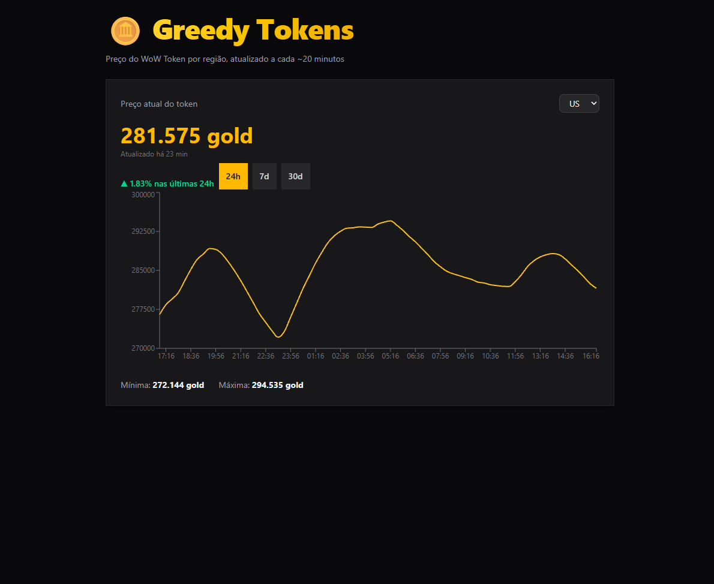

# 🪙 Greedy Tokens

Dashboard que acompanha o preço do **WoW Token** em tempo real, por região, com histórico de preços.

🔗 **Demo:** https://seu-projeto.vercel.app



## Funcionalidades

- Preço atual do token em gold, por região (US, EU, KR, TW)
- Gráfico histórico com períodos de 24h, 7d e 30d
- Variação percentual no período
- Indicador de última atualização
- Coleta automática do preço a cada ~20 minutos

## Stack

- **Front-end:** Next.js (App Router), React, TypeScript, Tailwind CSS, Recharts
- **Back-end:** rotas de API do Next.js
- **Banco:** PostgreSQL (Neon)
- **Integração:** API oficial da Blizzard (OAuth client credentials)
- **Deploy:** Vercel + agendador externo (cron-job.org)

## Como funciona

```
Agendador (a cada 20 min)
  → GET /api/collect (protegida por segredo)
  → busca o preço nas 4 regiões na API da Blizzard
  → grava no Postgres (sem duplicar)

Navegador
  → GET /api/token    (preço atual)
  → GET /api/history  (histórico por período)
```

## Rodando localmente

```bash
git clone https://github.com/seu-usuario/greedy-tokens.git
cd greedy-tokens
npm install
```

Crie um `.env.local` com:

```
BLIZZARD_CLIENT_ID=
BLIZZARD_CLIENT_SECRET=
DATABASE_URL=
CRON_SECRET=
```

Crie a tabela no Postgres:

```sql
CREATE TABLE token_prices (
  id SERIAL PRIMARY KEY,
  region TEXT NOT NULL,
  price_gold INTEGER NOT NULL,
  blizzard_updated_at TIMESTAMPTZ NOT NULL,
  created_at TIMESTAMPTZ NOT NULL DEFAULT NOW(),
  UNIQUE (region, blizzard_updated_at)
);
```

Depois:

```bash
npm run dev
```

## Decisões técnicas

- **Cache do access token** em memória, renovado antes de expirar.
- **Validação no servidor** de região e período, com type guards em TypeScript.
- **`UNIQUE` + `ON CONFLICT DO NOTHING`** evitam registros duplicados.
- **Agendador externo**, porque o cron do plano gratuito da Vercel só roda uma vez por dia.